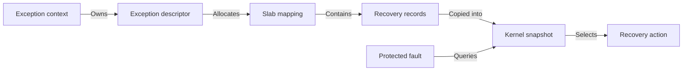
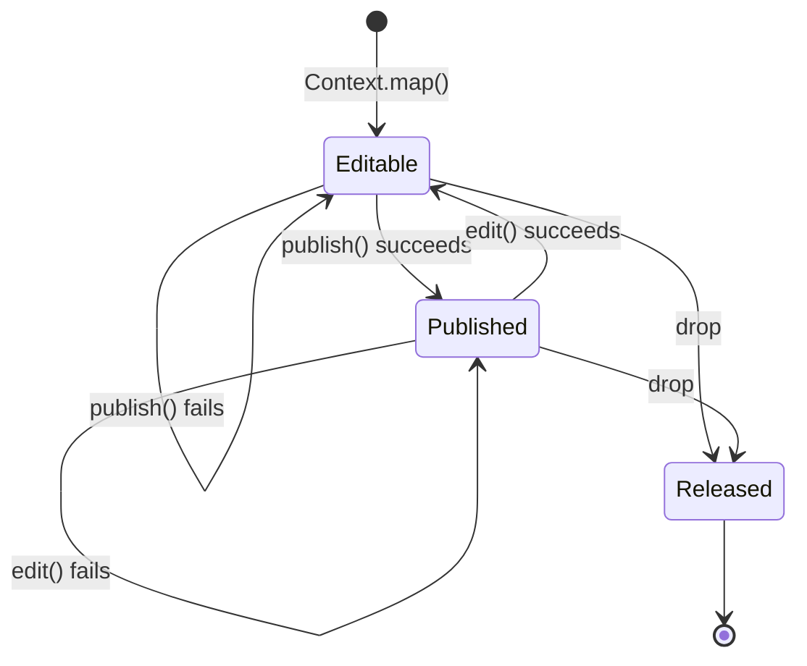
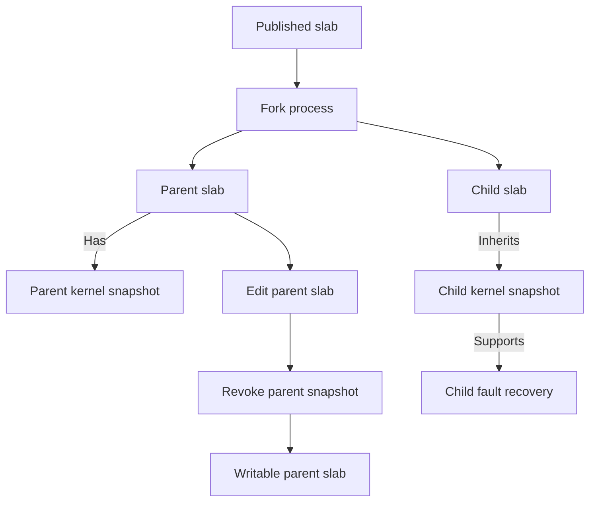

# `catalejo-sys`

`catalejo-sys` provides the Mirilla ABI bindings and low-level operations for
opening target sessions, mapping memory, and monitoring changes. Most
applications should use [`catalejo`](../catalejo), which manages these resources
and checks typed access bounds.

Direct users are responsible for the ownership, mapping, and lifetime
requirements documented on each operation.

Building the crate requires the C toolchain and `libclang` described in the
[workspace setup](../README.md#requirements).

## Exception recovery

Protected accesses need recovery records so Mirilla can redirect a supported
fault to the routine's recovery code. The `exception` module provides a
`Context` for allocating the slabs that hold these records and managing their
publication to the kernel.

A context owns the descriptor used to allocate slabs. Each slab has editable
userspace storage and, while published, a separate immutable kernel snapshot
used during fault handling.

The caller fills the slab while it is writable, then publishes it before the
records can participate in recovery. To change those records, the caller must
revoke publication first, so edits cannot alter records still used by the kernel.

| Slab state | Userspace mapping | Kernel snapshot | Mutable record access |
| --- | --- | --- | --- |
| Editable | Read-write | Absent | `record_list_mut()` returns `Some` |
| Published | Read-only | Installed | `record_list_mut()` returns `None` |

A failed transition leaves both the state and ownership unchanged, allowing the
caller to retry or release the slab. Calling `publish()` on a published slab,
or `edit()` on an editable slab, succeeds without changing its state.

Fork copies the storage and publication into the child's address space. The
inherited descriptor resolves to the child's context, so parent and child can
edit their records independently.

Because the published records are inherited, a child can use the inherited
fault backend without initializing it again. If the kernel cannot allocate
child slab storage during fork, the inherited range instead faults with
`SIGBUS` when accessed.
