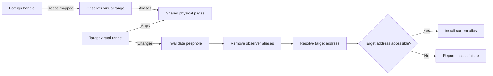
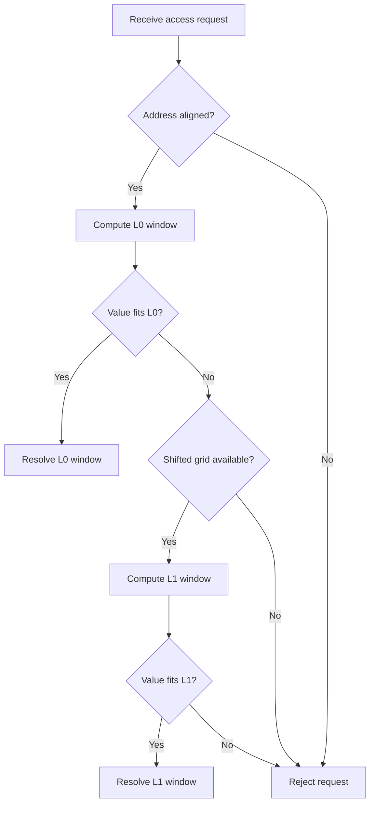

# `catalejo`

`catalejo` is the high-level userspace interface to the Mirilla kernel module.
It lets a Linux `x86_64` process observe another process through revocable
peephole mappings while keeping memory access fault protected.

The target keeps running while it is observed. Catalejo therefore does not
provide a process snapshot or make related reads atomic. If an application
depends on relationships between fields, it must validate those relationships
after observation.

## Core model

Start by engaging a process with [`Target`](crate::target::Target), then give
that target to a manager that resolves requests for its virtual addresses.
To serve a request, the manager reuses or opens a
[`Peephole`](crate::peephole::Peephole), which exposes the target range in the
observer's address space.

The request yields an access intent that can be converted into a
[`Foreign`](crate::peephole::Foreign) handle once the requested type's bounds
and alignment have been checked. That handle keeps the observer mapping alive,
but the target can still unmap or replace the underlying range. Protected
operations report failure if the mapping becomes unusable.

A peephole gives target and observer addresses access to the same physical
pages. The address changes, but reading through the alias does not copy the
page contents.



For a target address `a` in a window starting at `b`, the corresponding local
address is `observer_base + (a - b)`. A `Foreign` handle keeps the observer
mapping alive, but it cannot prevent target-side invalidation. After aliases
are removed, a later access can resolve replacement memory at the same target
address. Address-space teardown kills the peephole and prevents resolution.

Choose a [`Manage`](crate::manage::Manage) implementation to control window reuse.

- [`Memoize`](crate::manage::Memoize) opens tight page-aligned windows around
  requested spans. It is the preferred manager when a process observes itself.
- [`Rebased`](crate::manage::Rebased) uses fixed granule-sized windows and a
  second shifted grid for values that would otherwise straddle a granule
  boundary.
- [`Lru`](crate::manage::lru::Lru) uses the same placement model as `Rebased`
  with a limit on the number of peepholes held by the manager.

## Shifted granule grids

`Rebased` divides the target address space into windows of size `G`. A value
can cross a window boundary even when its size is much smaller than `G`, so a
second grid starts at an offset of `G / 2`. The manager tries the unshifted grid
first and uses the shifted grid when needed.

For example, with the default `G = 2 MiB`, a value occupying `[1.75, 2.25) MiB`
crosses the unshifted boundary at `2 MiB` but fits within `[1, 3) MiB` on the
shifted grid. Both grids describe target ranges, not observer mapping addresses.

```text
Target address (MiB)    0       1       2       3       4
                       |-------|-------|-------|-------|
L0 windows             [---------------)[---------------)
L1 window                      [---------------)
Value                                [---)
                                     1.75 2.25
```



For a grid with shift `s`, the frame index identifies a window relative to that
grid's origin. The offset then locates the value within that window.

| Quantity | Calculation |
| --- | --- |
| Frame index | `floor((a - s) / G)` |
| Target window base | `frame * G + s` |
| Offset within window | `a - window_base` |
| Fit requirement | `offset + n <= G`, with the required type alignment |

These calculations use wrapping address arithmetic in the implementation.
Values must be no larger than `G / 2` to meet the manager's size contract.
With `Granule::Page`, the half-granule shift is not page-aligned, so only `L0`
exists and the value must fit within its page. `Lru` uses the same placement
rules while limiting cache ownership across both grids.

## Example

The following example reads a `u64` from the current process through a
`Memoize` manager. Running it requires a loaded Mirilla module and access to
the configured device.

```no_run
use catalejo::{
    address::ViAddr,
    manage::{Manage, Memoize},
    target::Target,
};

fn main() -> Result<(), Box<dyn std::error::Error>> {
    let value = Box::new(0xDEAD_BEEF_CAFE_BABE_u64);

    let process_id = std::process::id().try_into()?;
    let target = Target::engage(process_id)?;
    let manager = Memoize::new(target);

    let address = core::ptr::from_ref(value.as_ref()).addr();
    let address = ViAddr::new(address.try_into()?);

    let access = manager
        .source::<u64>(address)?
        .ok_or_else(|| std::io::Error::other("manager cannot serve this address"))?;
    let foreign = access
        .foreign()
        .ok_or_else(|| std::io::Error::other("peephole was invalidated"))?;

    assert_eq!(foreign.read(), Some(*value));

    Ok(())
}
```

For a foreign process, pass its PID to
[`Target::engage`](crate::target::Target::engage) and use virtual addresses from
that process.

## Access semantics

[`Foreign::read`](crate::peephole::Foreign::read) is available for
[`Faultable`](catalejo_fault::behavior::Faultable) values. It performs a
fault-protected, machine-word-coherent read and returns `None` when the access
faults.

[`Foreign::copy`](crate::peephole::Foreign::copy) supports larger
[`Unassociated`](crate::offset::Unassociated) values. A concurrent writer may
tear the copied value across fields or bytes, so this operation does not create
a coherent snapshot.

The `write` feature adds
[`Foreign::write`](crate::peephole::Foreign::write). The store is fault
protected and reports whether it completed.

Removing invalidated aliases prevents access to stale frames. Because a later
access resolves the target address again, it may observe replacement memory at
that address. This does not suspend the target or synchronize with its threads.

## Typed traversal

[`Pointer`](crate::pointer::Pointer) models an address stored in the target
without turning it into a local Rust pointer. [`Field`](crate::offset::Field)
and [`Foreign::project`](crate::peephole::Foreign::project) provide typed
in-structure traversal while preserving the bounds and alignment of the
original foreign handle.

The derive macro re-exported as [`Field`](crate::offset::Field) can generate
field marker types for ordinary named structures. Sparse layouts can instead
use [`Sparse`](crate::offset::Sparse) and resolve the resulting access through
the active manager.

## Features

- `default-device-path` is enabled by default and lets
  [`Target::engage`](crate::target::Target::engage) use the configured Mirilla
  device path. Without it, use
  [`Target::engage_at`](crate::target::Target::engage_at) or
  [`Target::engage_with`](crate::target::Target::engage_with).
- `write` is enabled by default and enables protected writes through
  [`Foreign::write`](crate::peephole::Foreign::write).
- `stealth-mode` selects the matching stealth behavior in the lower-level
  Catalejo crates.

## Platform requirements

The crate currently targets Linux on `x86_64` and requires the Mirilla kernel
module. Observing another process also requires the permissions needed by
Mirilla, including `CAP_SYS_PTRACE` where applicable. Self-observation does
not require that capability.

The workspace README contains module setup, kernel build, testing, and benchmark
instructions.
